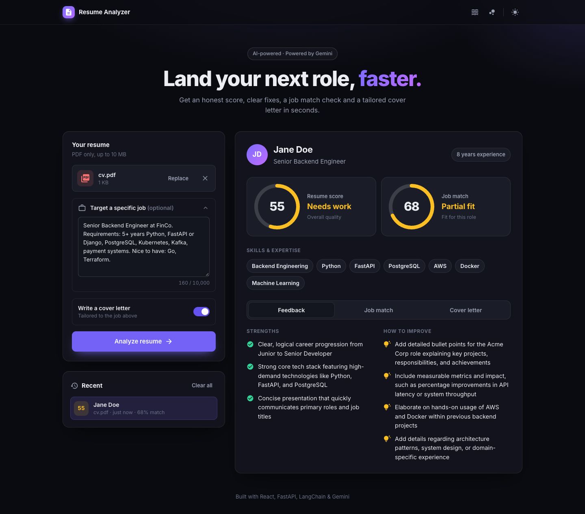
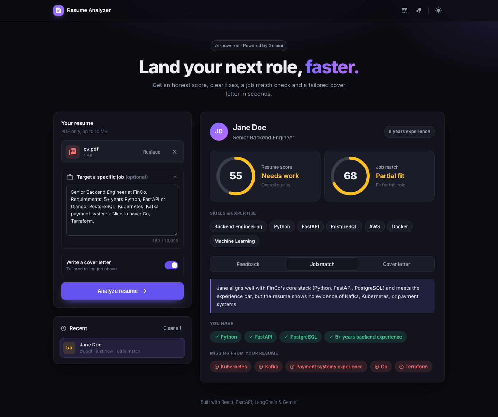
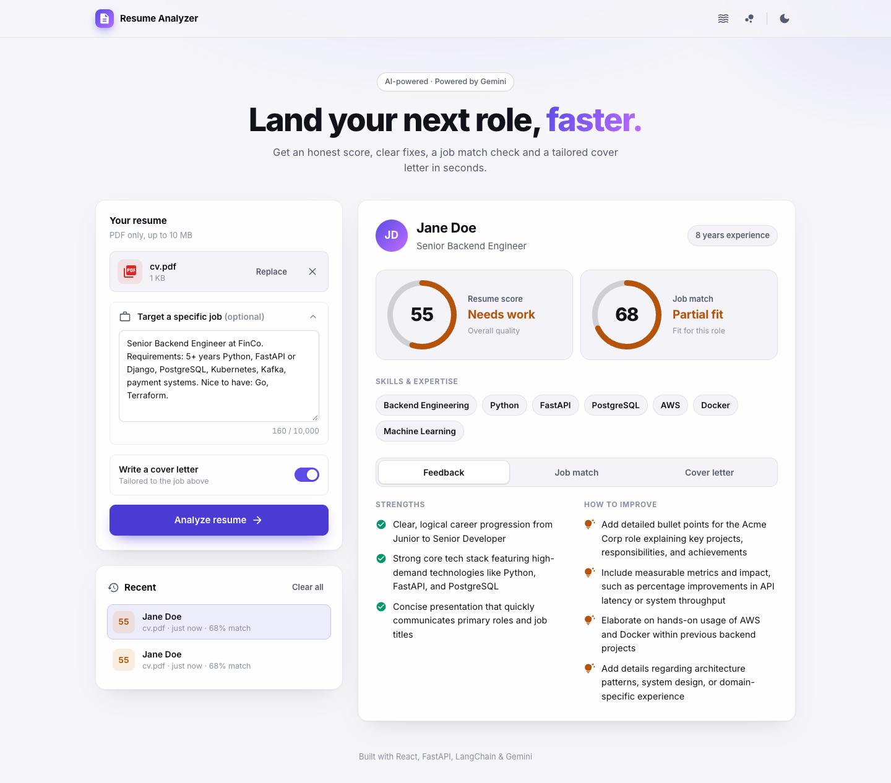
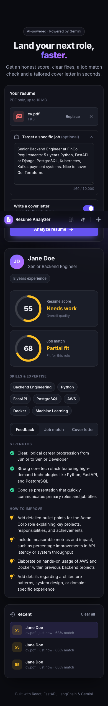
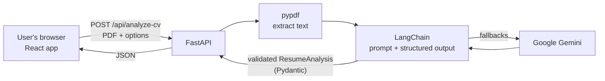

# AI Resume Analyzer

Upload a PDF resume and get an honest quality score, specific feedback, a job match check, and a tailored cover letter in seconds. Built with **React**, **FastAPI**, **LangChain**, and **Google Gemini**.



## Features

- **Resume score (0–100)** with an animated score ring, a list of strengths, and specific, actionable improvements
- **Job match:** paste a job description to get a match score, the skills you have, and the skills you're missing
- **Cover letter generator:** written from your resume (and tailored to the job, if you add one). Edit it on the page, copy it, or download it as **Word** or **PDF**
- **Drag & drop upload** with an inline PDF preview
- **History:** your last 6 analyses are saved in the browser so you can reopen them instantly
- **Dark / light mode** (remembers your choice) and optional animated backgrounds
- **Resilient AI calls:** if one Gemini model is overloaded, the app automatically falls back to the next one
- Fully **responsive**, works on phones

| Job match | Light mode | Mobile |
| --- | --- | --- |
|  |  |  |

## Tech stack

| Layer | Technology |
| --- | --- |
| Frontend | React 19 (Create React App), plain CSS with design tokens, MUI icons |
| Backend | FastAPI (Python), async endpoints |
| AI | LangChain + Google Gemini, structured output via Pydantic models |
| PDF parsing | pypdf |
| Downloads | `docx` (Word) and `jsPDF` (PDF), loaded on demand |
| Deployment | Docker (multi-stage build: one container serves the API and the website) |

## How it works



1. The React app sends the PDF, the cover-letter choice, and an optional job description to `POST /api/analyze-cv`.
2. FastAPI validates the upload and extracts the text with **pypdf**.
3. **LangChain** fills in the prompt and calls Gemini with `with_structured_output(ResumeAnalysis)`, so the model must return JSON matching a Pydantic schema (name, score, strengths, job match, …). If a model is unavailable, `with_fallbacks` tries the next one.
4. The backend double-checks the answer (e.g. keeps scores within 0–100) and returns it as JSON.
5. React renders the results. In production, FastAPI also serves the built React app, so everything runs on **one server and one URL**.

## Getting started

### Prerequisites

- **Python 3.14+**
- **Node.js 20+** and npm
- A free **Gemini API key** from [Google AI Studio](https://aistudio.google.com/apikey)

### 1. Clone the repository

```bash
git clone https://github.com/<your-username>/resume-analyzer.git
cd resume-analyzer
```

### 2. Set up the backend

```bash
python3 -m venv venv
source venv/bin/activate          # Windows: venv\Scripts\activate
pip install -r requirements.txt

cp .env.example .env              # then open .env and paste your Gemini API key
```

### 3. Set up the frontend

```bash
cd frontend
npm install
cd ..
```

### 4. Run it

**Development** (two terminals, both auto-reload when you save):

```bash
# Terminal 1: backend on http://localhost:8000
source venv/bin/activate
fastapi dev main.py

# Terminal 2: frontend on http://localhost:3000
cd frontend
npm start
```

Open **http://localhost:3000**. The React dev server forwards `/api/...` requests to FastAPI (see `"proxy"` in `frontend/package.json`), so there are no CORS issues.

**Production-style** (one server):

```bash
cd frontend && npm run build && cd ..
source venv/bin/activate
fastapi run main.py
```

Open **http://localhost:8000**.

### Run with Docker

```bash
docker build -t resume-analyzer .
docker run -p 8000:8000 --env-file .env resume-analyzer
```

Open **http://localhost:8000**.

## Environment variables

| Variable | Required | Description |
| --- | --- | --- |
| `GEMINI_API_KEY` | Yes | Your Google Gemini API key |
| `PORT` | No | Port for the Docker container (default `8000`; set automatically by most hosts) |

## API

Interactive docs are available at **`/docs`** while the backend is running.

| Method | Endpoint | Description |
| --- | --- | --- |
| `GET` | `/api/health` | Health check |
| `GET` | `/api/llm` | Sends a test message to Gemini to check the connection |
| `POST` | `/api/analyze-cv` | Analyzes a resume (multipart form, see below) |

`POST /api/analyze-cv` form fields:

| Field | Type | Description |
| --- | --- | --- |
| `resume` | file | The resume as a PDF |
| `cover_letter` | boolean | `true` to generate a cover letter |
| `job_description` | string (optional) | A job description to match against (max 10,000 characters) |

Example response:

```json
{
  "filename": "resume.pdf",
  "generate_cover_letter": true,
  "model_response": {
    "name": "Jane Doe",
    "headline": "Senior Backend Engineer",
    "experience": 8,
    "domain_expertise": ["Python", "FastAPI", "PostgreSQL"],
    "score": 72,
    "strengths": ["Clear career progression", "..."],
    "improvements": ["Add measurable results to the Acme Corp role", "..."],
    "job_match": {
      "match_score": 68,
      "matched_skills": ["Python", "FastAPI"],
      "missing_skills": ["Kubernetes", "Kafka"],
      "verdict": "Strong core stack, but no evidence of Kafka or Kubernetes."
    },
    "cover_letter": "Dear Hiring Manager, ..."
  }
}
```

## Project structure

```
resume-analyzer/
├── main.py              # FastAPI app: routes, PDF parsing, prompt, response schema
├── connect.py           # Gemini models + fallback chain (LangChain)
├── requirements.txt     # Python dependencies
├── .env.example         # Template for your .env file
├── Dockerfile           # Builds the frontend and runs everything in one container
├── docs/screenshots/    # Images used in this README
└── frontend/
    ├── package.json     # Includes the dev "proxy" to FastAPI
    ├── public/          # index.html, icons, manifest
    └── src/
        ├── App.js       # App state and layout
        ├── App.css      # All styles (design tokens at the top)
        ├── components/  # Header, UploadPanel, ResultsPanel, ScoreRing,
        │                # CoverLetter, HistoryList, BackgroundFx
        └── lib/         # api.js (backend calls), history.js, download.js
```

## Limitations & roadmap

- **Scanned (image-only) PDFs** aren't supported yet. They would need OCR.
- **No rate limiting or authentication**, so a public deployment could use up the Gemini quota.
- AI scores can vary slightly between runs for the same resume.
- History is stored per browser (localStorage), not synced to an account.
- Next up: backend tests with `pytest`, a server-side file size limit, and a downloadable full report.
